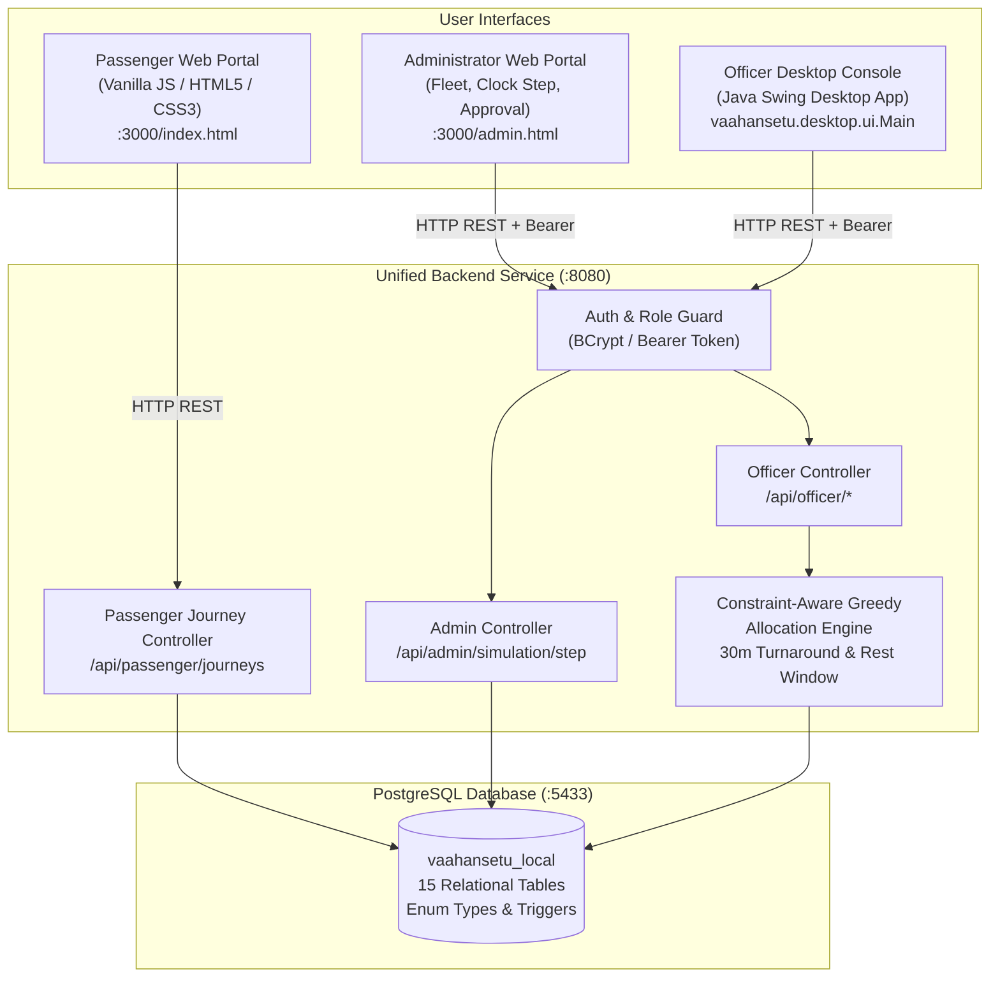

# VaahanSetu — Smart Bus Allocation and Crowd Management

VaahanSetu is an integrated intelligent transit management platform designed to optimize public bus allocation, track segment-level passenger demand, enforce mandatory driver rest windows, and synchronize operations across passengers, administrators, and transport officers in real time.

---

## 1. System Architecture



---

## 2. Integrated Modules & Interfaces

### A. Passenger Web Portal (`frontend/index.html`)
- **Route & Stop Selection:** Dynamically loads available bus routes, scheduled departure trips, and ordered stops.
- **Journey Booking:** Registers passenger journeys with seat count validation (1–10 passengers).
- **Interactive Lifecycle Actions:** Allows passengers to record boarding (`BOARDED`) and alighting/completion (`COMPLETED`), or cancellation with real-time feedback.
- **Demand Visualization:** Live display of current segment demand along the chosen route.

### B. Administrator Web Portal (`frontend/admin.html`)
- **Authentication:** Secure login for administrators with role verification (`ADMIN`).
- **Fleet & Availability:** Live overview of bus inventory, seating capacities, and driver rest windows.
- **Session Planning (SRS F4 / U2):** Configure operational bus and route selection for the active planning session, stored in `session_routes` and `session_buses`.
- **Departures & Assignments:** Scheduled trips table with current bus assignments and segment demand drill-down.
- **Simulation Control:** Single-click +2 minute virtual clock advancement and signed passenger demand injection.
- **Allocation Optimization:** Run greedy allocation engine, compare baseline vs. proposed metrics, and execute one-click approvals.

### C. Officer Desktop Console (`officer-desktop/`)
- **Java Swing Desktop Application:** Fully integrated with live backend REST APIs.
- **Real-Time Visual Mode Indicator (SRS NFR-S4):** Displays unambiguous visual badges (`● LIVE BACKEND` vs `● DEMO / OFFLINE MODE`) on the login screen, title bar, and header so operators never mistake mock mode for live operation.
- **Fleet Inspection:** Bus capacity and driver mandatory rest window monitoring.
- **Segment Demand Analytics:** Segment-by-segment passenger load inspection.
- **Proposals & Approval:** Generates optimization proposals, inspects unmet demand reduction, and persists approved assignments to the operational schedule.

### D. Unified Spring Boot Backend (`backend/`)
- **Single Source of Truth:** Centralized Spring Boot 3.5.6 service with Spring JDBC and Hikari connection pooling.
- **Role-Based Security:** BCrypt password hashing for `ADMIN` and `OFFICER` roles.
- **Greedy Allocation Engine:** Considers segment peak demand, bus capacity, 30-minute turnarounds, and fixed driver rest windows.

---

## 3. Default Credentials

| Role | Username | Password | Access Rights |
| :--- | :--- | :--- | :--- |
| **Administrator** | `admin` | `admin123` | Full administrative simulation, clock advancement, allocation approval, fleet control |
| **Transport Officer** | `officer1` | `officer123` | Session selection, segment demand review, allocation proposals, and proposal approval |
| **Transport Officer (Alt)** | `officer` | `officer123` | Secondary officer account |

---

## 4. Quick Start (Windows PowerShell)

Ensure Docker Desktop is running.

### One-Click Launch (All Services)
To start the database, backend, web servers, and officer desktop interface together in separate windows:
```powershell
.\start-all.ps1
```

### Individual Service Launchers
If you wish to run services individually:

1. **Start Backend (Spring Boot on Port 8080):**
   ```powershell
   .\start-backend.ps1
   ```
2. **Start Web Frontend (Port 3000):**
   ```powershell
   .\start-frontend.ps1
   ```
   - Passenger Portal: `http://localhost:3000/index.html`
   - Admin Portal: `http://localhost:3000/admin.html`
3. **Start Officer Desktop Console (Java Swing):**
   ```powershell
   .\start-officer.ps1
   ```

---

## 5. Verification and Automated Testing

### A. End-to-End Integration Suite (`test-e2e.ps1`)
Runs an automated 19-assertion integration test verifying the entire workflow:
```powershell
powershell -File .\test-e2e.ps1
```
*Verifies: Route listing &rarr; Stop loading &rarr; Trip selection &rarr; Journey registration &rarr; Duplicate journey rejection (within 2-min window) &rarr; Boarding/Alighting confirmation &rarr; Officer/Admin authentication &rarr; Session bus & route selection &rarr; Role authorization enforcement (403 forbidden) &rarr; Authentication enforcement (401 unauthorized) &rarr; Segment demand retrieval &rarr; Greedy allocation calculation &rarr; Baseline vs Proposed comparison &rarr; Authorized proposal approval &rarr; Database persistence &rarr; Operational schedule update &rarr; Admin simulation clock step.*

### B. Officer Desktop Smoke Tests (`test.bat`)
Runs the teammate's unit and live API smoke checks (34/34 checks passing):
```cmd
cd officer-desktop
test.bat
```

### C. Backend Unit Tests (`mvn test`)
Runs Spring Boot backend unit tests (4/4 tests passing):
```powershell
cd backend
mvn test "-Duser.timezone=UTC"
```

---

## 6. Core REST API Reference

| Method | Endpoint | Authorization | Description |
| :--- | :--- | :--- | :--- |
| `POST` | `/api/auth/login` | Public | Authenticates user; returns JWT/bearer token and role |
| `GET` | `/api/routes` | Public | Returns all active transit routes |
| `GET` | `/api/routes/{id}/stops` | Public | Returns ordered stops for a route |
| `GET` | `/api/routes/{id}/trips` | Public | Returns scheduled departures for a route |
| `POST` | `/api/passenger/journeys` | Public | Registers a passenger journey (rejects duplicates within 2 min) |
| `GET` | `/api/passenger/journeys/{id}`| Public | Fetches journey status and details |
| `PATCH`| `/api/passenger/journeys/{id}/status` | Public | Updates journey status (`BOARDED`, `COMPLETED`, `CANCELLED`) |
| `PUT`  | `/api/officer/sessions/{id}/selection` | Officer / Admin | Saves session active routes and buses into `session_routes` and `session_buses` |
| `PUT`  | `/api/admin/sessions/{id}/selection`   | Admin Only | Administrator route & bus selection configuration for active session |
| `GET` | `/api/officer/buses` | Officer / Admin | Returns fleet inventory and rest windows |
| `GET` | `/api/officer/trips` | Officer / Admin | Returns scheduled trips with current bus assignments |
| `GET` | `/api/officer/trips/{tripId}/demand` | Officer / Admin | Returns segment-level passenger demand |
| `POST` | `/api/officer/allocations` | Officer / Admin | Runs allocation engine and returns proposal |
| `POST` | `/api/officer/allocations/approve` | Officer / Admin | Persists approved proposal into `trip_assignments` |
| `POST` | `/api/admin/simulation/step` | Admin Only | Advances virtual clock (+2 min) and injects signed demand deltas |

---

## 7. Database Configuration

- **Active Primary Database:** Shared Cloud PostgreSQL on **Neon** (`ep-rough-mode-azjj7ke6.c-3.ap-southeast-1.aws.neon.tech`).
  - **Database Name:** `vaahansetu`
  - **User:** `neondb_owner`
  - **Connection Pooling:** HikariCP with cloud serverless keep-alive (`keepalive-time=30000`, `max-lifetime=60000`).
- **Optional Local Fallback Database:** PostgreSQL 17 Docker container (`vaahansetu-postgres`) on port `5433` (`vaahansetu_local`).
  - To run backend against local Docker DB instead of Neon:
    ```powershell
    .\start-backend.ps1 -Local
    ```
- **Schema Preservation:** Uses strict PostgreSQL custom enums (`journey_status`, `assignment_status`, `allocation_status`, `allocation_assignment_type`) and integrity check triggers (`fn_pj_check_stop_order`, `fn_pj_confirmations`). Matches 100% between Neon and local environments.
