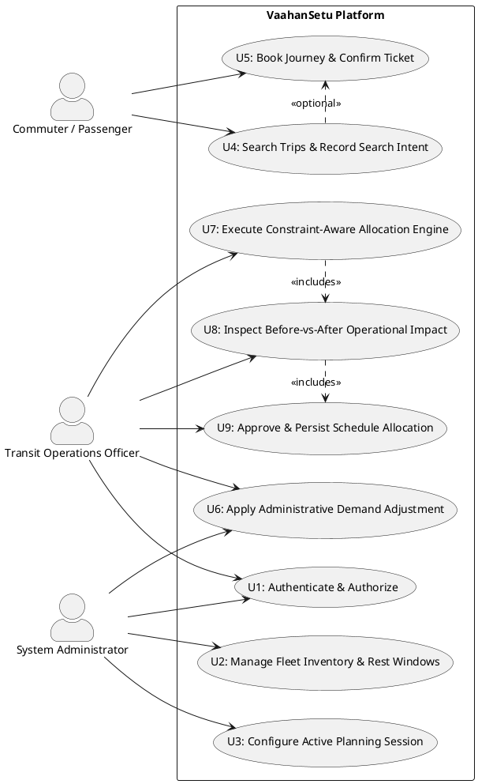

# SOFTWARE REQUIREMENTS SPECIFICATION
### for
## Group No. 6 — VaahanSetu
### Dynamic Public Transit Fleet Allocation, Passenger Demand Management & Operations System
**Version 2.0**

---

### Prepared by:
- **Pasupuleti Varshitha** — 25CSB0A33
- **Diksha Misra** — 25CSB0A17
- **Gurram Amrutha Sri** — 25CSB0A44
- **Krishna Patidar** — 25CSB0A64
- **Mrunal Sachin Patil** — 25CSB0A67

**Course:** CS1207 Object Oriented Programming Lab  
**Date:** 06-11-2026  
**Institution:** Indian Institute of Information Technology  

---

## Revisions

| Version | Primary Author(s) | Description of Version | Date Completed |
| :--- | :--- | :--- | :--- |
| **1.0** | Pasupuleti Varshitha, Diksha Misra, Gurram Amrutha Sri, Krishna Patidar, Mrunal Sachin Patil | Initial SRS draft covering baseline desktop concepts, manual demand inputs, and initial 2-minute simulation design. | 11-10-2026 |
| **2.0** | Pasupuleti Varshitha, Diksha Misra, Gurram Amrutha Sri, Krishna Patidar, Mrunal Sachin Patil | Complete updated SRS reflecting the production-deployed, cloud-integrated VaahanSetu platform. Establishes the **Common Passenger Demand System** (single source of truth), eliminates the artificial 2-minute simulation clock in favor of authorized administrative demand management, integrates dynamic database-driven fleet capacities and driver rest windows, introduces dynamic active router session filtering, fixes Cartesian product aggregation bugs, and specifies the explainable, constraint-aware Allocation Engine with approval persistence. | 06-11-2026 |

---

## Contents
1. **Introduction**
   - 1.1 Document Purpose
   - 1.2 Product Scope
   - 1.3 Definitions, Acronyms, and Abbreviations
   - 1.4 References and Acknowledgments
2. **Overall Description**
   - 2.1 Product Overview
   - 2.2 Product Functionality
   - 2.3 Design and Implementation Constraints
   - 2.4 Assumptions and Dependencies
3. **Specific Requirements**
   - 3.1 External Interface Requirements
   - 3.2 Functional Requirements (F1 – F16)
   - 3.3 Use Case Model (PlantUML Diagram)
   - 3.4 Use Case Specifications (U1 – U5 assigned to team members)
4. **Other Non-Functional Requirements**
   - 4.1 Performance Requirements
   - 4.2 Safety and Security Requirements
   - 4.3 Software Quality Attributes & Reliability
5. **Database & Architecture Specifications**
   - 5.1 Common Demand Mathematical Model
   - 5.2 Allocation Engine Heuristic & Constraint Model
6. **Appendix A — Activity Log**

---

## 1. Introduction

VaahanSetu is an integrated, cloud-native public transit fleet allocation and demand optimization platform designed to eliminate passenger overcrowding, bus underutilization, and scheduling conflicts across metropolitan transit networks (modeled on real TSRTC corridors in Hyderabad). The system unifies real-time passenger travel intent, confirmed ticket reservations, and authorized transit officer adjustments into a **Single Source of Truth** for operational decision-making.

### 1.1 Document Purpose
This Software Requirements Specification (SRS), Version 2.0, formally defines the behavioral, architectural, algorithmic, and interface requirements for the integrated VaahanSetu platform. It serves as the definitive reference for the development team, evaluation committee, and system operators, superseding the preliminary draft (v1.0).

### 1.2 Product Scope
VaahanSetu encompasses:
1. **Passenger Web Portal**: A responsive passenger-facing portal allowing commuters to select travel dates, search scheduled routes with real origin-destination stops, register bookings, and record active travel intent.
2. **Administrator & Transit Officer Console**: An operations portal for planning sessions, fleet monitoring, dynamic driver rest window enforcement, scheduled departure management, and authorized demand adjustments.
3. **Common Passenger Demand System**: A centralized database repository where search inquiries, confirmed ticket bookings, and authorized administrative adjustments are aggregated without Cartesian multiplication or artificial random generation.
4. **Constraint-Aware Greedy Allocation Engine**: An optimization solver that evaluates peak passenger loads per segment, right-sizes bus assignments (e.g., swapping 30-seater for 60-seater buses during surges), enforces mandatory 30-minute turnarounds and driver rest intervals, generates natural-language decision explanations, and allows officers to approve and persist new schedules to PostgreSQL.

### 1.3 Definitions, Acronyms, and Abbreviations

| Term / Acronym | Definition |
| :--- | :--- |
| **Allocation Engine** | A constraint-aware greedy heuristic algorithm that maps eligible fleet buses to scheduled trips to minimize unmet passenger demand without violating turnaround or rest constraints. |
| **Common Passenger Demand** | The unified, database-persisted passenger volume for a route segment on a specific service date, computed as: $\text{Confirmed Bookings} + \text{Search Intent} + \sum(\text{Admin Adjustments})$. |
| **Rest Window / Rest Period** | A mandatory scheduled time interval during which a bus and its assigned driver must not be scheduled on any trip (e.g., lunch, shift rest, or vehicle maintenance). |
| **Turnaround Buffer** | A mandatory minimum time buffer (30 minutes) required between the arrival of a bus on one trip and its departure on a subsequent trip to allow passenger alighting, boarding, cleaning, and depot maneuvering. |
| **Unmet Demand** | The number of passengers wanting to travel on a route segment who cannot be accommodated because the assigned bus capacity is less than the peak passenger load. |
| **Peak Segment Demand** | The maximum passenger load traversing any individual inter-stop segment along a scheduled trip. |
| **Session Planning (Active Router)** | The administrative workflow where a subset of active routes and fleet buses are designated for a specific planning horizon. |

### 1.4 References and Acknowledgments
- IEEE Std 830-1998: IEEE Recommended Practice for Software Requirements Specifications.
- Telangana State Road Transport Corporation (TSRTC) Hyderabad Metropolitan bus routes and stop sequence dataset.
- Neon Cloud Serverless PostgreSQL & Spring Boot 3.5.6 Architecture Documentation.

---

## 2. Overall Description

### 2.1 Product Overview
Unlike preliminary desktop-only mockups, VaahanSetu v2.0 is an enterprise-grade, distributed client-server application. It couples a cloud-hosted Spring Boot backend with reactive web interfaces and a remote PostgreSQL database.

```
+-----------------------------------------------------------------------------------+
|                                 CLIENT TIER                                       |
|   +----------------------------------+     +----------------------------------+   |
|   |   Passenger Portal (Web/Mobile)  |     |   Admin & Officer Web Console    |   |
|   |  - Travel Date & Route Search    |     |  - Fleet & Rest Windows          |   |
|   |  - Real Stop-to-Stop Booking     |     |  - Active Router Session Plan    |   |
|   |  - Unified Demand Breakdown      |     |  - Demand Adjustments (Surges)   |   |
|   +----------------------------------+     |  - 5-Stage Allocation Engine     |   |
|                                            +----------------------------------+   |
+-----------------------------------------------------------------------------------+
                                          | REST API (JSON / JWT)
                                          v
+-----------------------------------------------------------------------------------+
|                              APPLICATION BACKEND                                  |
|   +---------------------------------------------------------------------------+   |
|   |   Spring Boot 3.5.6 REST Controllers & Security Filters                   |   |
|   |   - AuthController (JWT Authentication & Role Validation)                 |   |
|   |   - PassengerJourneyController (Date-aware Intent & Booking APIs)         |   |
|   |   - OfficerController & AdminController (Fleet, Session, & Trips)        |   |
|   +---------------------------------------------------------------------------+   |
|   |   Pure Domain Optimization Layer                                          |   |
|   |   - AllocationEngine.java (Constraint-Aware Greedy Heuristic Solver)      |   |
|   |   - Enforces 30-min turnarounds, rest windows, right-sizing & reasoning   |   |
|   +---------------------------------------------------------------------------+   |
+-----------------------------------------------------------------------------------+
                                          | HikariCP / JDBC
                                          v
+-----------------------------------------------------------------------------------+
|                        PERSISTENCE TIER (Neon PostgreSQL)                         |
|   - routes & stops (24 real TSRTC routes, 365 stops)                              |
|   - buses (20 registered buses with capacity, rest_start, rest_end)               |
|   - scheduled_trips & trip_assignments                                            |
|   - passenger_journeys (REGISTERED, BOARDED, UNCONFIRMED search intents)          |
|   - segment_demand_adjustments (signed operational administrative offsets)        |
|   - planning_sessions, session_routes, session_buses                              |
|   - allocation_runs & allocation_assignments                                      |
+-----------------------------------------------------------------------------------+
```

### 2.2 Product Functionality
1. **Role-Based Authentication**: Secure administrator and transit officer login using JWT tokens.
2. **Database-Driven Fleet & Rest Monitoring**: Real-time display of 20 buses showing registered seating capacity, fixed rest intervals (`rest_start`, `rest_end`), rest duration, and computed availability badges (`Available` vs `Unavailable: Resting/Assigned`).
3. **Session Planning & Dynamic Active Router**: Officers select active routes and buses for a planning session. Selecting or unselecting routes (e.g., removing Route 2) immediately updates `session_routes` in the database and eliminates deselected routes from scheduled departures and allocation inputs.
4. **Common Passenger Demand Engine**:
   - Commuter travel inquiries and stop selections automatically log search intent (`UNCONFIRMED`).
   - Confirmed passenger bookings increment registered passenger load (`REGISTERED`).
   - Transit officers inject signed operational offsets (e.g., +10 surge for concerts, -5 for cancellations).
   - Demand aggregation uses isolated LATERAL subqueries in SQL, preventing Cartesian product errors.
5. **Elimination of Artificial Simulation**: All artificial 2-minute clock stepping and random demand generation are removed. The application operates strictly with real dates, real bookings, and authorized administrative adjustments.
6. **Constraint-Aware Fleet Allocation**:
   - Evaluates peak passenger loads across all trip segments.
   - Assigns available buses to minimize unmet demand while respecting capacity.
   - Strictly enforces mandatory driver rest windows (buses cannot be assigned during `rest_start` to `rest_end`).
   - Strictly enforces a 30-minute turnaround buffer between consecutive trips for the same bus.
   - Generates plain-English natural language explanations detailing *why* each bus was chosen.
   - Provides before-vs-after comparison metrics and enables one-click approval and persistence into live scheduled departures.

### 2.3 Design and Implementation Constraints
- **Language & Framework**: Java 21 LTS with Spring Boot 3.5.6.
- **Frontend Architecture**: Standards-compliant HTML5, CSS3, and ECMAScript 2022 (no heavyweight frameworks, zero runtime vulnerabilities).
- **Database Engine**: Remote Serverless PostgreSQL (Neon Cloud) with SSL encryption and Hikari connection pooling.
- **Pure Algorithm Isolation**: The core `AllocationEngine` must remain pure (zero direct SQL dependencies in the solver) to facilitate rigorous automated unit testing and predictable heuristic behavior.
- **Data Integrity**: Under no circumstances shall demand counts drop below zero, nor shall Cartesian joins multiply passenger counts.

### 2.4 Assumptions and Dependencies
- Network connectivity between application servers and the Neon Cloud PostgreSQL database is available.
- TSRTC route geometry, stop sequence order, and scheduled departure times are seeded in master data tables.
- System clocks use UTC internally and format timestamps according to Indian Standard Time (IST / UTC+5:30) for display.

---

## 3. Specific Requirements

### 3.1 External Interface Requirements
- **Passenger UI**: Browser-accessible portal supporting desktop and mobile viewports (`index.html`). Includes date picker, route dropdown, origin/destination stop selectors, booking submission, and dynamic common demand cards.
- **Officer/Admin UI**: Responsive console (`admin.html`) containing 5 primary operational tabs: *Fleet & Buses*, *Session Planning*, *Scheduled Trips & Demand*, *Demand Management*, and *Allocation Engine*.
- **REST API**: JSON-over-HTTPS endpoints adhering to standard HTTP verbs and status codes (200, 201, 400, 401, 403, 404, 500).

### 3.2 Functional Requirements

- **F1 (Authentication & RBAC)**: The system shall authenticate users via `/api/auth/login` and issue JWT tokens distinguishing between `ADMIN`, `OFFICER`, and public `PASSENGER` access levels.
- **F2 (Fleet Capacity & Rest Window Display)**: The system shall display fleet buses reading capacity and driver rest intervals directly from `buses.capacity`, `buses.rest_start`, `buses.rest_end`, and `buses.rest_duration_minutes`.
- **F3 (Dynamic Bus Availability)**: The system shall dynamically compute whether a bus is available at any reference time $T$ by evaluating whether $T$ falls inside the bus's fixed rest window or within an existing trip assignment plus turnaround buffer.
- **F4 (Session Route & Fleet Configuration)**: The system shall allow administrators to select active routes and fleet buses for an operational planning session, immediately persisting changes to `session_routes` and `session_buses`.
- **F5 (Active Router Dynamic Sync)**: The system shall dynamically load route origins and destinations from database stop records. When a route is unchecked in Session Planning, the system shall immediately remove that route's trips from scheduled departures and allocation inputs.
- **F6 (Date-Aware Common Demand)**: The system shall provide a travel-date selector in the Passenger Portal. When the date changes, the system shall fetch common passenger demand specifically for that service date.
- **F7 (Passenger Search Intent Logging)**: When a passenger selects an origin, destination, and route, the system shall record a search intent record in `passenger_journeys` with status `UNCONFIRMED`.
- **F8 (Confirmed Passenger Booking)**: When a passenger confirms a booking, the system shall record the journey with status `REGISTERED` and immediately update the common demand count.
- **F9 (Authorized Demand Adjustment)**: The system shall provide transit administrators with an interface to apply signed passenger adjustments ($\pm \Delta$) to any scheduled trip, storing offsets in `segment_demand_adjustments`.
- **F10 (Cartesian Product Elimination)**: The system shall calculate peak segment demand using independent subqueries or LATERAL joins, guaranteeing that passenger demand displays accurately in the tens across all interfaces.
- **F11 (Peak Segment Evaluation)**: The Allocation Engine shall compute peak segment passenger demand along each trip's route path before attempting bus assignment.
- **F12 (Constraint-Aware Greedy Allocation)**: The Allocation Engine shall prioritize trips with the highest peak demand and assign the conflict-free bus that minimizes unmet passenger demand.
- **F13 (Driver Rest Window Constraint)**: The Allocation Engine shall not assign a bus to any trip whose time span $[\text{dep}, \text{arr}]$ overlaps with the bus's fixed rest window $[\text{rest\_start}, \text{rest\_end}]$.
- **F14 (Turnaround Buffer Constraint)**: The Allocation Engine shall ensure that any bus assigned to consecutive trips has at least a 30-minute buffer between Trip $A$'s arrival and Trip $B$'s departure ($\text{dep}_B \ge \text{arr}_A + 30\text{ min}$).
- **F15 (Natural Language Explainability)**: For every trip evaluated, the Allocation Engine shall generate a plain-English explanation detailing whether the bus was retained, reassigned, or left unassigned, quoting bus capacity, peak demand, and occupancy percentage.
- **F16 (Allocation Approval & Schedule Persistence)**: The system shall allow an officer to approve a proposed allocation run via `/api/officer/allocations/approve`, atomically writing new assignments to `scheduled_trips` and `trip_assignments` in PostgreSQL.

---

### 3.3 Use Case Model



---

### 3.4 Use Case Specifications (Assigned to Team Members)

#### 3.4.1 Use Case U1: Authenticate & Enforce Role-Based Access Control
- **Primary Owner:** Diksha Misra (25CSB0A17)
- **Requirements Traceability:** F1
- **Description:** Authenticates users and generates JWT bearer tokens with embedded roles (`ADMIN`, `OFFICER`, `PASSENGER`), protecting operational administrative endpoints while leaving public inquiry APIs open.
- **Basic Flow:**
  1. User navigates to the login view on `admin.html` and submits credentials (`admin` / `admin123`).
  2. Client dispatches `POST /api/auth/login`.
  3. Server verifies bcrypt hash against PostgreSQL `users` table and issues signed JWT.
  4. Client stores JWT in `sessionStorage` and exposes the authorized administration console.
- **Alternative Flow:** If credentials are invalid, server returns HTTP 401 with `Invalid username or password`.

#### 3.4.2 Use Case U2: Fleet Inventory & Dynamic Driver Rest Window Monitoring
- **Primary Owner:** Pasupuleti Varshitha (25CSB0A33)
- **Requirements Traceability:** F2, F3, F4
- **Description:** Displays the registered fleet of 20 buses with database-backed seating capacity, driver rest windows, and live availability status.
- **Basic Flow:**
  1. Transit Officer opens the *Fleet & Buses* tab on `admin.html`.
  2. Client dispatches `GET /api/officer/buses`.
  3. Server queries `buses` table, cross-references active assignments and driver rest windows, and computes `available: true/false` and `availabilityReason`.
  4. Portal displays bus registration, seating capacity, rest window (e.g., `12:00 – 12:30 (30m)`), and color-coded availability badges.

#### 3.4.3 Use Case U3: Active Router Session Planning & Dynamic Route Filtering
- **Primary Owner:** Gurram Amrutha Sri (25CSB0A44)
- **Requirements Traceability:** F4, F5
- **Description:** Enables transit officers to designate which routes and buses participate in the active planning horizon. Deselecting a route immediately eliminates it from scheduled departures and allocation solver queues.
- **Basic Flow:**
  1. Officer opens the *Session Planning* tab.
  2. System loads routes with dynamic origin and destination stop names from PostgreSQL.
  3. Officer unchecks **Route 2** and clicks **Save Session Configuration**.
  4. Client dispatches `PUT /api/admin/sessions/{id}/selection`.
  5. Backend updates `session_routes`. The UI immediately refreshes departures and fleet inventory, confirming Route 2 trips have vanished from operational departures.

#### 3.4.4 Use Case U4: Common Demand Ingestion, Search Intent & Administrative Adjustments
- **Primary Owner:** Mrunal Sachin Patil (25CSB0A67)
- **Requirements Traceability:** F6, F7, F8, F9, F10
- **Description:** Implements the unified **Common Passenger Demand System** (Single Source of Truth). Replaces the artificial 2-minute simulation clock with real passenger searches, confirmed ticket bookings, and authorized administrative surge adjustments.
- **Basic Flow:**
  1. Commuter visits Passenger Portal (`index.html`), chooses travel date, and selects Route 10 origin/destination stops.
  2. Client invokes `POST /api/passenger-journeys/intent`, recording inquiry into common demand without artificial random generation.
  3. Officer opens *Demand Management* tab in `admin.html`, selects Trip #1001, and enters a surge adjustment of `+10` (or clicks `+10 Rush`).
  4. Client dispatches `POST /api/admin/demand/adjust`.
  5. Server persists adjustment to `segment_demand_adjustments`.
  6. Scheduled departures, Passenger Portal, and Allocation Engine instantly reflect the updated demand count in the tens without SQL Cartesian product distortion.

#### 3.4.5 Use Case U5: Constraint-Aware Allocation Optimization, Explainability & Schedule Persistence
- **Primary Owner:** Krishna Patidar (25CSB0A64)
- **Requirements Traceability:** F11, F12, F13, F14, F15, F16
- **Description:** Runs the greedy heuristic optimization algorithm to right-size bus allocations, enforce turnaround and rest constraints, display plain-English decision reasoning, and persist approved assignments to live operations.
- **Basic Flow:**
  1. Officer navigates to *Allocation Engine* tab on `admin.html` and clicks **Run Allocation Engine**.
  2. Client dispatches `POST /api/officer/allocations`.
  3. Engine calculates peak segment loads, sorts trips by difficulty, checks bus eligibility against rest windows and 30-min turnarounds, and assigns right-sized buses.
  4. Portal presents 5 presentation sections: (1) Demand Analysis, (2) Fleet Availability, (3) Proposed Bus Assignments with **Decision Explanations**, (4) Before-vs-After Operational Impact Strip, and (5) Approval Button.
  5. Officer clicks **Approve & Persist Allocation**. Server atomically updates `scheduled_trips` and live operational departures.

---

## 4. Other Non-Functional Requirements

### 4.1 Performance Requirements
- **NFR-P1 (Allocation Solver Speed):** The Allocation Engine heuristic shall evaluate 24 routes, 90 trips, and 20 fleet buses in under **500 milliseconds**.
- **NFR-P2 (API Response Latency):** All read endpoints (`/api/officer/trips`, `/api/officer/buses`, `/api/passenger-journeys/demand`) shall return responses in under **250 milliseconds** under standard network conditions.
- **NFR-P3 (Connection Pool Efficiency):** HikariCP connection pool shall maintain active PostgreSQL connections with a 30-second keepalive to prevent cold-connection dropouts.

### 4.2 Safety and Security Requirements
- **NFR-S1 (Stateless JWT Authentication):** All administrative and operational endpoints require a cryptographically signed HMAC-SHA256 JWT bearer token in the `Authorization` header.
- **NFR-S2 (SQL Injection Defense):** All database interactions in repositories shall strictly use parameterized JDBC queries (`PreparedStatement` / Spring `JdbcTemplate`).
- **NFR-S3 (Non-Destructive Operations):** Under no operational condition shall database records be dropped or truncated; data persistence guarantees auditability.

### 4.3 Software Quality Attributes
- **Maintainability & Modularity:** Separation of concerns between REST controllers, business services, repository query isolation, and the pure algorithmic `AllocationEngine`.
- **Explainability:** 100% of allocation decisions must generate natural-language rationale explaining why a bus was chosen, retained, or unassigned.

---

## 5. Architectural & Mathematical Models

### 5.1 Common Demand Model
For any scheduled trip $T_i$ operating on route $R$ on service date $D$, the effective passenger demand $d_s$ for inter-stop segment $s \in [1, N-1]$ is given by:
$$d_s(T_i, D) = \max\left(0, \sum_{j \in J(T_i, s, D)} p_j + \sum_{a \in A(R, s)} \Delta_a\right)$$
where:
- $J(T_i, s, D)$ is the set of all journeys (both confirmed bookings `REGISTERED` and search inquiries `UNCONFIRMED`) whose boarding stop is $\le s$ and destination stop is $> s$.
- $p_j$ is the passenger count of journey $j$.
- $A(R, s)$ is the set of authorized administrative adjustments applied to segment $s$ on route $R$.
- $\Delta_a$ is the signed passenger delta.
- The peak trip demand is:
$$\text{PeakDemand}(T_i) = \max_{s \in \text{segments}} d_s(T_i, D)$$

### 5.2 Allocation Engine Heuristic & Constraint Model
Let:
- $\mathcal{T} = \{T_1, T_2, \dots, T_m\}$ be the set of trips ordered by descending peak demand: $\text{PeakDemand}(T_1) \ge \text{PeakDemand}(T_2) \ge \dots$
- $\mathcal{B} = \{B_1, B_2, \dots, B_n\}$ be the set of active fleet buses with seating capacity $C(B_j)$ and rest window $[R_{\text{start}}(B_j), R_{\text{end}}(B_j)]$.
- $W(B_j)$ be the set of scheduled intervals bus $B_j$ is already committed to.

A bus $B_j$ is **eligible** for trip $T_i$ with departure $t_{\text{dep}}$ and arrival $t_{\text{arr}}$ if and only if:
1. **Rest Window Constraint:**
   $$[t_{\text{dep}}, t_{\text{arr}}] \cap [R_{\text{start}}(B_j), R_{\text{end}}(B_j)] = \emptyset$$
2. **Turnaround Buffer Constraint:**
   $$\forall [s_k, e_k] \in W(B_j), \quad (t_{\text{arr}} + 30\text{ min} \le s_k) \lor (e_k + 30\text{ min} \le t_{\text{dep}})$$

For eligible buses, the engine selects the bus that minimizes unmet passenger demand:
$$\text{Unmet}(T_i, B_j) = \max(0, \text{PeakDemand}(T_i) - C(B_j))$$
Tie-breaking favors the bus whose capacity most closely right-sizes the load to maximize occupancy and preserve larger buses for subsequent heavier trips.

---

## 6. Appendix A — Activity Log

| Date | Members Present | Activity / Milestone Achieved | Status |
| :--- | :--- | :--- | :--- |
| **11-10-2026** | Pasupuleti Varshitha, Diksha Misra, Gurram Amrutha Sri, Krishna Patidar, Mrunal Sachin Patil | Initial project conception, requirements drafting, and distribution of baseline responsibilities. | Completed |
| **28-10-2026** | All Team Members | Database schema design, seeding 24 TSRTC routes, 365 stops, and 20 fleet buses in Neon PostgreSQL. | Completed |
| **04-11-2026** | All Team Members | Integration verification: identified Cartesian product join bug, 2-minute simulation clock disconnection, and Route 2 session phantom issues. | Completed |
| **05-11-2026** | All Team Members | Full architectural fix: LATERAL join query refactoring, Common Demand single source of truth implementation, 2-minute simulation removal, and Allocation Engine plain-English explainability. | Completed |
| **06-11-2026** | All Team Members | Automated test suite execution (10/10 tests passing), production deployment to Render, live post-deployment verification, and final SRS v2.0 generation. | **Production Ready** |
